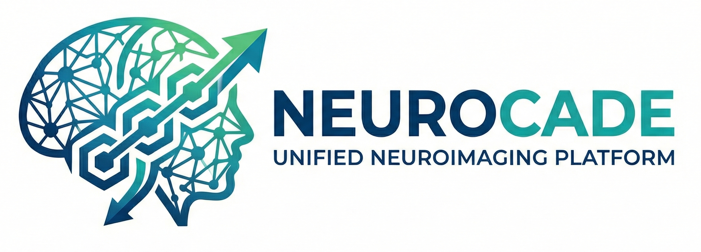

# NeuroCade

NeuroCade is a neuroimaging workspace for managing MRI cases, running containerized processing tools, and coordinating AI-assisted analysis workflows.
It can be used as a local app or installed on a server and accessed through a web browser.
Learn more on [NeuroCade.org](https://NeuroCade.org).

## Quick Start

Download and run the latest stable release installer:

```bash
curl -fL --retry 3 -o neurocade-install.sh https://github.com/Deep-MI/NeuroCade/releases/latest/download/neurocade-install.sh && bash neurocade-install.sh --mode local
```

The download must succeed before setup starts. Each release includes
`neurocade-install.sh` and its SHA-256 checksum. The installer defaults to the
exact release it came from, even when a newer release appears during setup.
For a fixed version, replace `latest/download` with `download/<release-tag>`.
Stable never silently selects a beta release.

Use `bash neurocade-install.sh --version beta` for the newest beta, or
`--version <release-tag>` for a specific release. These options work with both
Docker and Apptainer. Docker builds from the verified source archive; Apptainer
downloads the matching verified SIF and bridge. Separate rolling Docker images
are not accepted by the standalone installer.

On macOS, install and start Docker Desktop first. On Linux amd64, install Docker
or rootless Apptainer; if both are available, setup offers a runtime menu.
Python 3 and curl are required for the initial release verification.
The installer manages its own application Python toolchain afterwards.

Interactive setup offers provider and model choices, with manual model entry
when discovery is unavailable. Use arrow keys and Enter, or the numbered menu
on basic terminals. Explicit flags take precedence. `--yes` disables all prompts;
provide required credentials and model names through the environment or existing
configuration. The default assistant choice is “Configure later.”

If `curl` is unavailable, download the installer using `wget` (install curl before running setup):

```bash
wget -O neurocade-install.sh https://github.com/Deep-MI/NeuroCade/releases/latest/download/neurocade-install.sh && bash neurocade-install.sh --mode local
```

From a development checkout:

```bash
./scripts/install.sh --runtime docker --mode local
# Or build a matched Apptainer SIF from this checkout (requires Docker):
./scripts/install.sh --runtime apptainer --mode local --build-from-source
./scripts/run.sh status
```

For server installs, choose `--mode internal`. More detailed install
instructions are in [INSTALL.md](INSTALL.md).

## Release publishing

The release workflow publishes versioned Docker images to `docker.io/deepmi/neurocade`,
with `beta` and `latest` channel tags for beta and stable releases respectively.
The Docker Hub repository must be public so release validation and Apptainer
conversion can pull the image anonymously.

Configure these GitHub Actions secrets before running the release workflow:

- `DOCKERHUB_USERNAME`: the Docker Hub account used to publish images.
- `DOCKERHUB_TOKEN`: an access token for that account with push access to `deepmi/neurocade`.

GitHub releases continue to host the application SIF, bridge wheel, verified
source archive, checksums, and release manifest. Installer-owned archive
installs can update transactionally with `./scripts/update.sh --yes`; Git
checkouts remain under Git control.

### Retrying a partial release

On the failed Release run, choose **Re-run failed jobs**. Each run saves its
version and source commit in a `release-plan` artifact before building. A rerun
restores that plan, even if `main` or the calendar date has changed.

Images are built under `staging-<run-id>-<attempt>` tags. These are temporary
validation images, not supported release versions. Only after Docker and
Apptainer smoke tests pass does publication upload the assets to a draft GitHub
release, promote the validated image to its version tag, and publish the release.
The `beta` or `latest` channel is updated last.

If publication is interrupted, a rerun completes the same draft and accepts an
existing Git tag only when it points to the original commit. Once the GitHub
release is public, reruns preserve its image and assets and only repair its
channel tag. Retrying an older version does not move a newer channel backwards.
Scheduled and manual releases share a concurrency group to prevent overlapping
publication.

The plan is retained for 90 days, subject to repository retention limits. If a
run failed before saving its plan, start a new workflow run. Do not delete the
plan artifact while a release needs recovery. Runs from before this retry
support was introduced continue to use their original workflow.

Docker Hub and GitHub cannot publish atomically: a failure during final
publication can still leave a versioned image or Git tag alongside a draft.
Rerunning completes that state. Staging tags remain available for debugging and
can be removed from Docker Hub after the release is complete or abandoned.
### Local MCP agents

For optional local agent access to NeuroCade and FastSurfer, see [MCP setup and usage](MCP.md).
